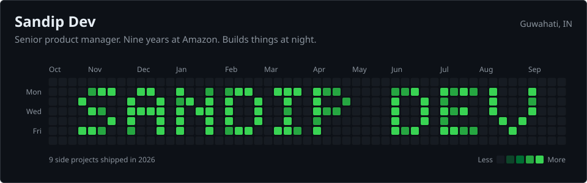
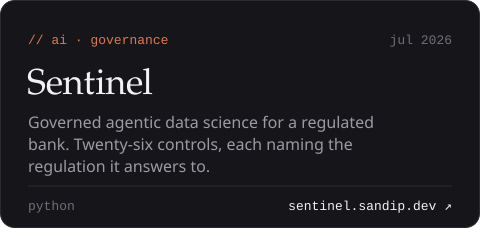
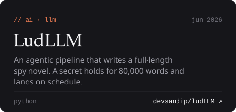
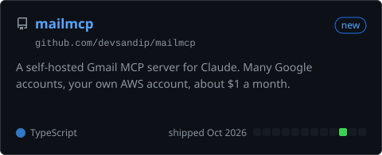
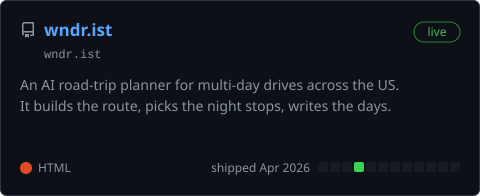
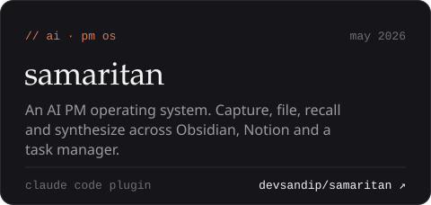
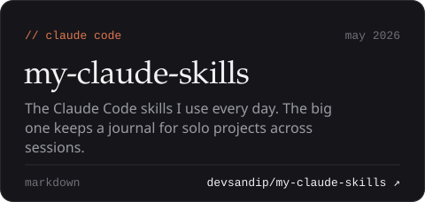

I'm a product manager. Thirteen years of working out what people actually want versus what they say they want, nine of them at Amazon. Most recently I ran the global product charter for country-level network planning ($700M in free cash flow saved in 2024).

By night I write code. Partly because I miss it, partly because the fastest way to know if an idea is any good is to ship the smallest version and let it tell you.

### Built at night

Also on the bench: [samaritan-os](https://github.com/devsandip/samaritan-os), one inbox for everything my agents need me to approve, and [scrask-bot](https://github.com/devsandip/scrask-bot), screenshot to calendar. None of them are trying to be startups. All of them scratch a specific itch.

### Currently

- **Building** [wndr.ist](https://wndr.ist), plus an AI OS to run as much of my life as it can
- **Reading** *Humble Pi: When Math Goes Wrong in the Real World*
- **Drinking** Pegasus Coffee, Winslow's Revenge. Double shot, no milk.
- **Thinking** about why most dashboards lie politely
- **Avoiding** people

### Elsewhere

[sandip.dev](https://sandip.dev) · [Blog](https://www.blog.sandip.dev/) · [LinkedIn](https://www.linkedin.com/in/devsandip) · [Medium](https://sandipdev.medium.com/) · [Drop a message](https://sandip.dev/#/contact)

Guwahati, IN. Formerly Dallas, Seattle, Bangalore, and at least three coffee shops you've never heard of.
